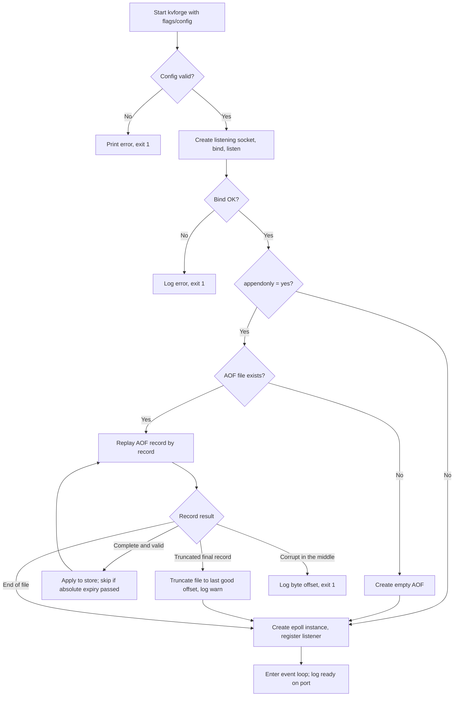
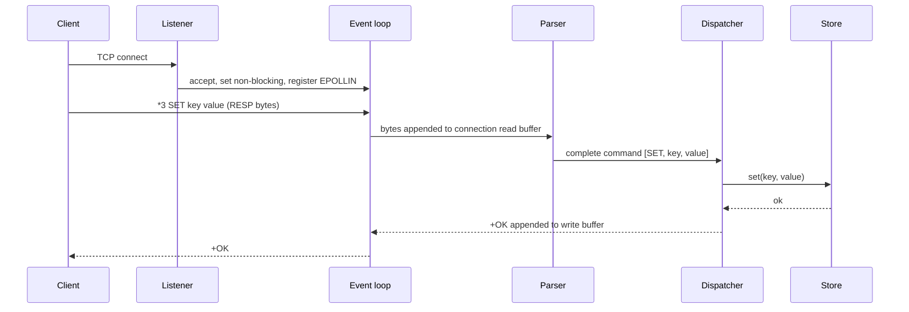
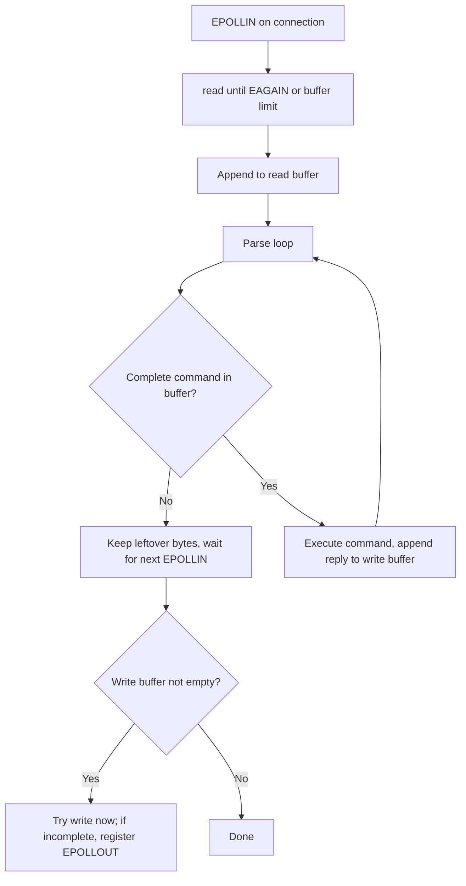
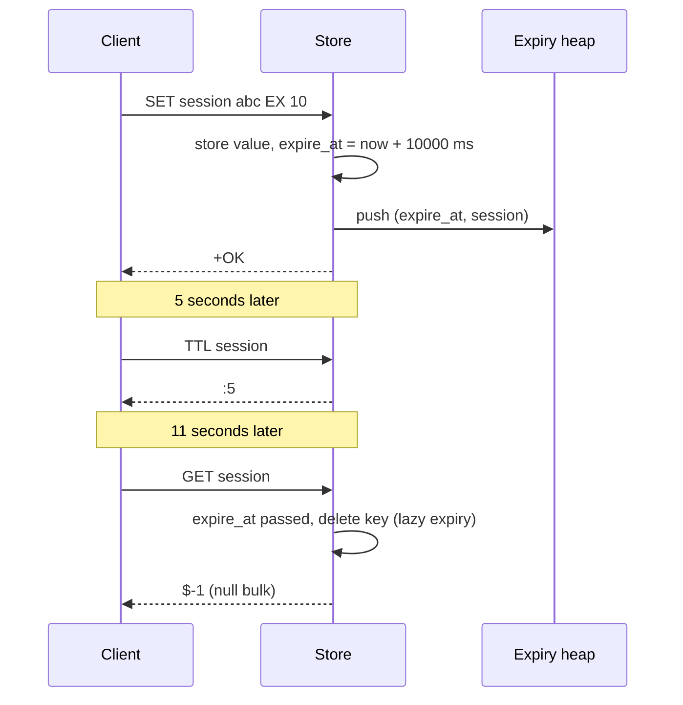
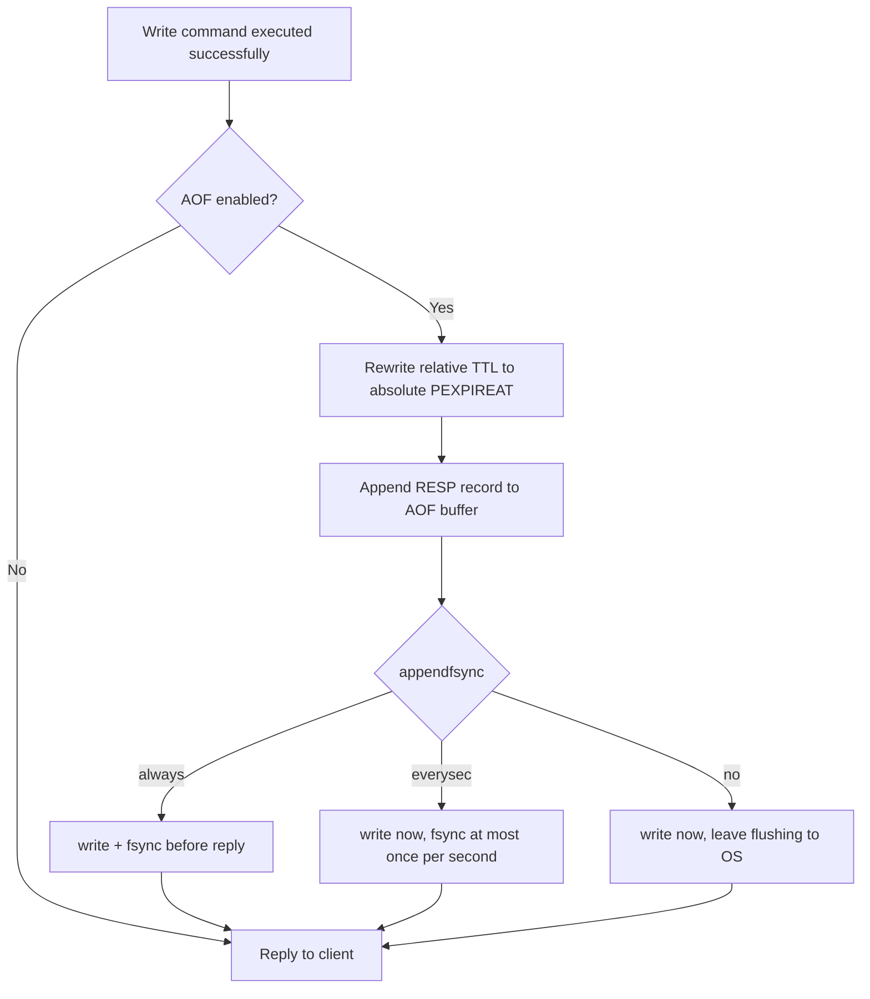
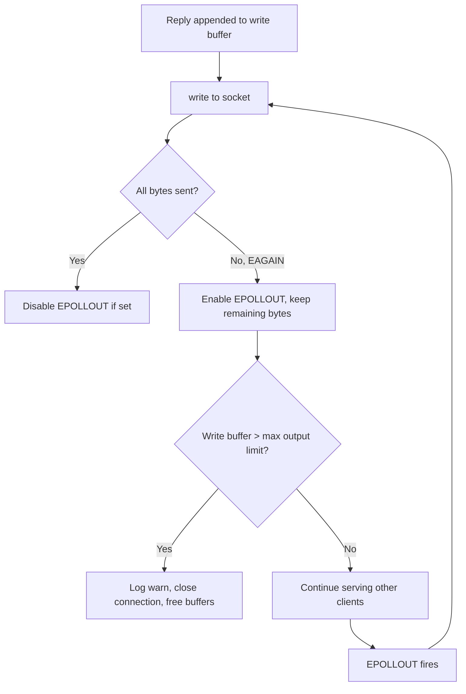
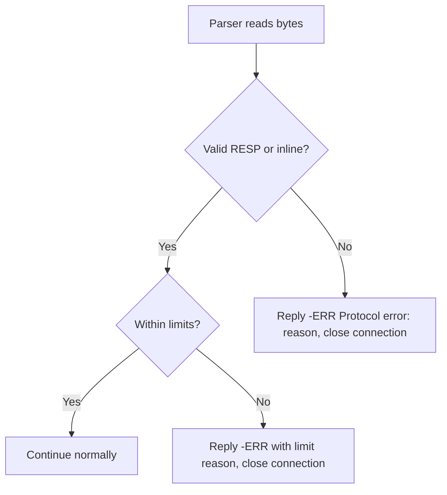
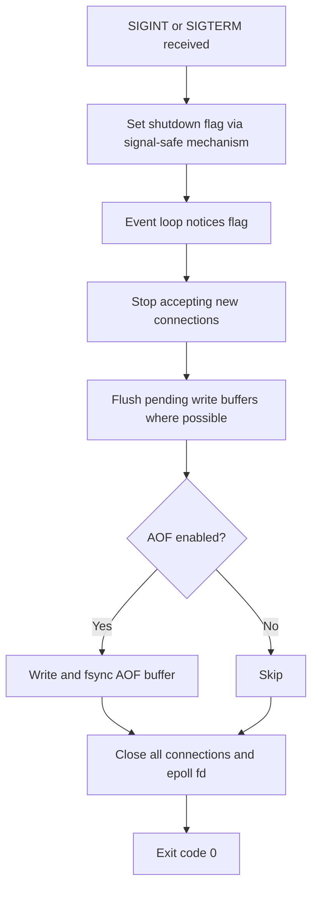
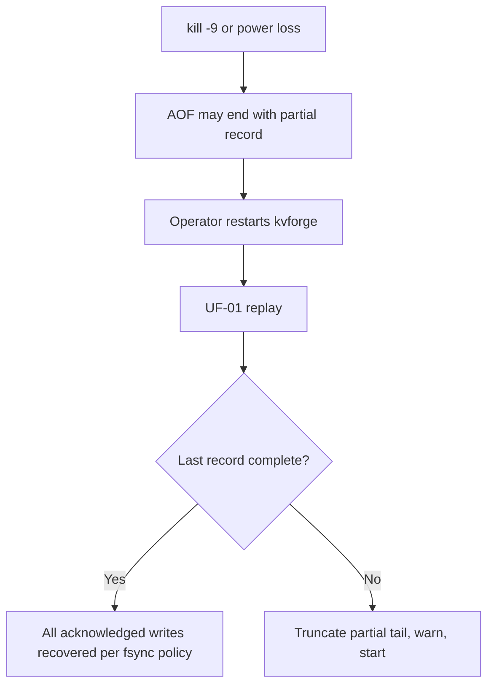
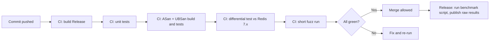

# KVForge — User Flows

All diagrams use Mermaid. Flow IDs are referenced by acceptance criteria and tests.

## 1. Flow index
| ID | Flow | Actor |
|---|---|---|
| UF-01 | Server startup and AOF recovery | Operator |
| UF-02 | Client connects and runs a command | Application developer |
| UF-03 | Partial and pipelined requests | Application developer |
| UF-04 | SET with expiry, then access | Application developer |
| UF-05 | Active expiry in the event loop | System |
| UF-06 | Write path with AOF and fsync policy | System |
| UF-07 | Slow client and backpressure | System |
| UF-08 | Protocol error or limit violation | Application developer |
| UF-09 | Graceful shutdown | Operator |
| UF-10 | Crash and recovery | Operator |
| UF-11 | Verification workflow (tests and benchmarks) | Reviewer / Contributor |

## 2. UF-01 Startup and AOF recovery


## 3. UF-02 Connect and run a command


## 4. UF-03 Partial and pipelined requests

Rules: replies are always in command order; a half-received command never produces a reply; leftover bytes are kept per connection.

## 5. UF-04 SET with expiry then access


## 6. UF-05 Active expiry
```mermaid
flowchart TD
    A[Event loop iteration] --> B[epoll_wait with timeout = min(next expiry, 100 ms)]
    B --> C[Handle ready events]
    C --> D[Start expiry cycle with time budget]
    D --> E{Heap top expire_at <= now?}
    E -- No --> J[End cycle]
    E -- Yes --> F[Pop entry]
    F --> G{Key exists and its current expiry equals entry?}
    G -- No --> H[Stale entry, discard] --> K
    G -- Yes --> I[Delete key, expired_keys++, append DEL to AOF] --> K
    K{Budget exhausted?}
    K -- No --> E
    K -- Yes --> J
    J --> A
```

## 7. UF-06 Write path with AOF


## 8. UF-07 Slow client and backpressure


## 9. UF-08 Protocol error or limit violation

Examples of violations: bulk length above 64 MiB, array length above 1,048,576, query buffer above 128 MiB, inline line above 64 KiB, invalid length digits, missing `\r\n`.

## 10. UF-09 Graceful shutdown


## 11. UF-10 Crash and recovery

Durability expectations: `always` recovers every acknowledged write; `everysec` can lose up to about one second; `no` depends on the OS.

## 12. UF-11 Verification workflow
