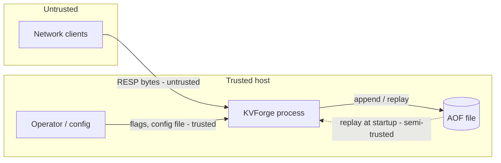

# KVForge — Security Architecture

KVForge is a learning-grade, unauthenticated server. Its security posture is "safe by default on a trusted host, bounded against abusive input, honest about what it does not protect". This document defines the controls; `security/THREAT_MODEL.md` (Batch 4) covers threats in detail.

## 1. Security goals
| ID | Goal |
|---|---|
| SG-1 | The server never executes attacker-controlled code or shell commands. |
| SG-2 | Untrusted input cannot cause memory corruption, crashes or unbounded memory growth. |
| SG-3 | The default configuration does not expose the server to the network. |
| SG-4 | Persistent data is not readable by other local users by default. |
| SG-5 | Limitations are documented so nobody mistakes KVForge for a hardened production service. |

## 2. Trust boundaries

- Network bytes are always untrusted.
- Flags and the config file are trusted (operator-controlled).
- The AOF is semi-trusted: it is written by KVForge but may be truncated or corrupted by crashes or tampered with by someone with file access. It is parsed with the same strict parser as network input.

## 3. Controls

### 3.1 Network exposure
| Control | Detail |
|---|---|
| Loopback default | `--bind 127.0.0.1`. Binding to a non-loopback address logs a `warn`: "Binding to a non-loopback address without authentication exposes all data to the network". |
| No authentication | `AUTH` is unsupported by design; documented as a non-goal. Operators needing remote access must use a firewall, SSH tunnel or private network. |
| No TLS | Documented non-goal. |
| Connection cap | `--max-clients` (default 10,000) bounded also by the process file-descriptor limit; the server reads `RLIMIT_NOFILE` at startup and lowers `max_clients` to `limit - 32` if needed, logging a warning. |

### 3.2 Input validation and resource limits (denial-of-service resistance)
| Limit | Default | Behavior on violation |
|---|---|---|
| Bulk string length | 64 MiB | `-ERR Protocol error: invalid bulk length`, close |
| Array length | 1,048,576 | `-ERR Protocol error: invalid multibulk length`, close |
| Inline line length | 64 KiB | `-ERR Protocol error: too big inline request`, close |
| Query buffer per client | 128 MiB | close |
| Output buffer per client | 64 MiB | close |
| Clients | 10,000 | reject new connection |
| `KEYS` result size | unlimited but documented O(N) blocking | none |

Parser rules that prevent classic bugs:
- Length fields are parsed with explicit digit-count and overflow checks (max 19 digits then compared); no `atoi`/`strtol` without range checks.
- All size arithmetic uses `size_t` with overflow checks before allocation (`a + b` checked against `SIZE_MAX`).
- A declared bulk length does **not** cause an upfront allocation of that size. Memory grows only as bytes actually arrive (prevents "declare 64 MiB, send nothing" memory pinning by many connections), and total per-connection memory stays under the query-buffer limit.
- No recursion in the parser (no stack exhaustion).
- Commands are looked up in a fixed table; there is no dynamic dispatch on attacker-controlled strings beyond hashing for lookup.

### 3.3 Hash-flooding resistance
- Seeded hash function with a per-process random seed from `getrandom` (see `DATABASE_DESIGN.md` §3.1). An attacker cannot precompute colliding keys without knowing the seed.
- Incremental rehashing bounds latency spikes even if long chains occur.
- Known limitation: not a cryptographic keyed hash; SipHash upgrade path documented.

### 3.4 Slow-client and idle-client handling
- Slow readers: bounded output buffer, then disconnect (AC-LIM-04).
- Slow writers (slowloris-style): bounded per-connection memory and the connection cap limit the impact. An idle-timeout option is **not** implemented in Tier 1/2 and is listed as a limitation. Mitigation: operators may use OS-level TCP keepalive settings; KVForge enables `SO_KEEPALIVE` on accepted sockets.

### 3.5 File handling
| Control | Detail |
|---|---|
| AOF permissions | Created with mode `0600` (owner read/write only). |
| AOF path | Taken only from the trusted `--appendfilename` flag; never derived from network input. |
| No path traversal | No command takes a filesystem path. `CONFIG SET` is not implemented (no runtime changes to file locations). |
| Truncation safety | Recovery truncates only the incomplete tail record and only at a verified record boundary. |
| Corruption handling | Corrupt AOF in the middle: refuse to start, never "best-effort" apply. |

### 3.6 Memory safety practices
- Modern C++: RAII, `std::string`, `std::vector`; raw `new`/`delete` confined to `HashTable` entry management with unit and sanitizer coverage.
- No `strcpy`, `sprintf`, `gets` or other unsafe C string functions; format with `std::snprintf` with explicit sizes or `std::to_chars`.
- Compiled with `-Wall -Wextra -Wpedantic -Werror`; optional hardening flags in Release: `-D_FORTIFY_SOURCE=2 -fstack-protector-strong -fPIE -pie -Wl,-z,relro,-z,now`.
- ASan and UBSan in CI for the full test suite; libFuzzer on the parser and AOF loader.

### 3.7 Information disclosure
- Error replies never include internal pointers, file paths or stack traces.
- `INFO` exposes process id, port and OS string (same as Redis); it contains no keys or values.
- Logs never contain key or value contents at `info` level or above. At `debug` level only command names and byte counts are logged. Values are never logged at any level.

### 3.8 Signals and process safety
- Signals handled through `signalfd` (no async-signal-unsafe code in handlers).
- `SIGPIPE` ignored; writes to closed sockets return `EPIPE` and close the connection.
- The server does not drop privileges itself; operators should run it as an unprivileged user (documented in the deployment guide).

### 3.9 Supply chain
- No third-party runtime dependencies.
- Test dependencies pinned (GoogleTest tag, Python requirements with versions).
- CI uses pinned action versions (commit SHAs where practical).
- Release artifacts accompanied by SHA-256 checksums.

## 4. Security testing
| Activity | Frequency |
|---|---|
| Unit tests for limit enforcement (AC-LIM-01..04) | Every commit |
| ASan/UBSan full test run | Every commit |
| libFuzzer: parser and AOF loader, 60 s smoke run on every PR, ≥ 1 hour before each release | PR and release |
| Malformed-input corpus (negative lengths, huge lengths, missing CRLF, nested arrays, binary junk, 1-byte-at-a-time delivery) | Every commit |
| Manual abuse tests: 10,000 idle connections, slow reader, large pipeline | Before each release |

## 5. Known limitations (to publish in README)
1. No authentication or authorization.
2. No encryption in transit (no TLS) and none at rest.
3. `KEYS *` can block all clients on a large keyspace.
4. No idle-client timeout.
5. FNV-1a with random seed is not collision-proof against a determined adversary.
6. The AOF has no checksums; mid-file corruption is detected only if it breaks RESP structure or replay.
7. Single-threaded: one slow command delays all clients.
8. Wall-clock changes shift key expiry deadlines.

## 6. Operator guidance (for DEPLOYMENT.md)
- Keep the default loopback bind unless you control the network path.
- Place KVForge behind a firewall rule that allows only trusted hosts.
- Run as an unprivileged user with a dedicated data directory (`chmod 700`).
- Do not store secrets or personal data in KVForge without additional protections.