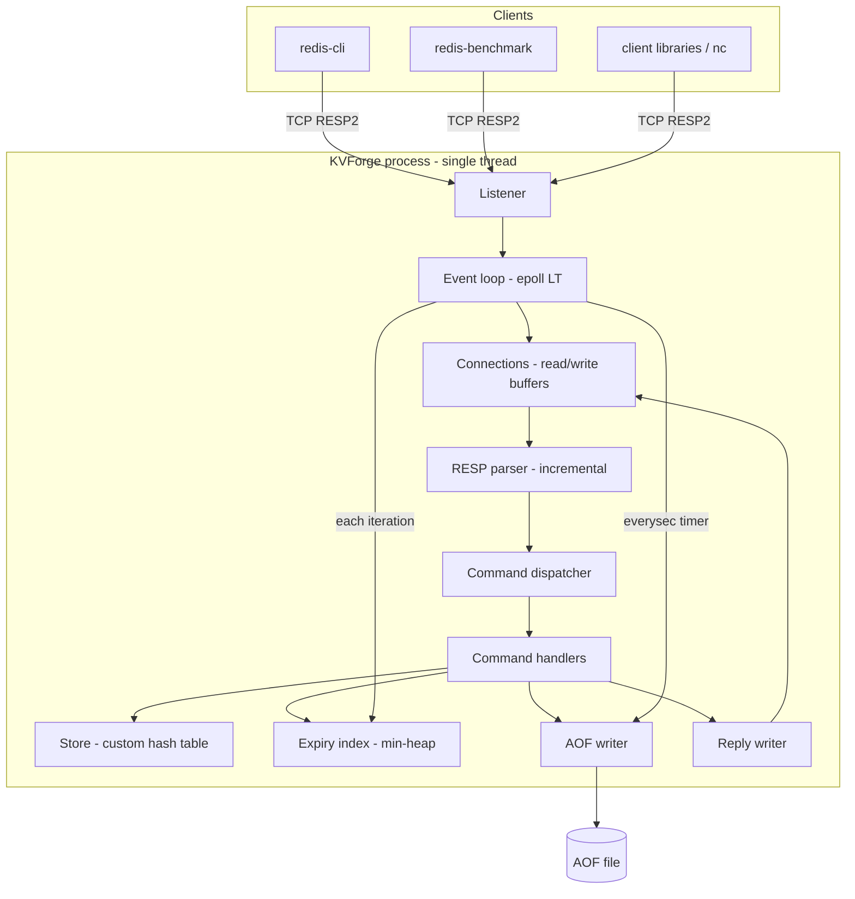

# KVForge — System Architecture

## 1. Overview
KVForge is one process with one thread. A level-triggered `epoll` event loop multiplexes a listening socket, client sockets, a `signalfd` and (optionally) nothing else. Commands execute synchronously on the loop thread, so every command is atomic without locks.



## 2. Source layout
```
kvforge/
├── CMakeLists.txt
├── src/
│   ├── main.cpp                  # parse config, start server
│   ├── config/    config.hpp/.cpp
│   ├── net/       event_loop.hpp/.cpp, listener.hpp/.cpp, connection.hpp/.cpp, socket_util.hpp/.cpp
│   ├── protocol/  resp_parser.hpp/.cpp, resp_writer.hpp/.cpp
│   ├── store/     entry.hpp, hash_table.hpp/.cpp, store.hpp/.cpp
│   ├── expiry/    expiry_index.hpp/.cpp
│   ├── persistence/ aof_writer.hpp/.cpp, aof_loader.hpp/.cpp
│   ├── commands/  command_table.hpp/.cpp, string_cmds.cpp, key_cmds.cpp, server_cmds.cpp
│   └── util/      clock.hpp, log.hpp/.cpp, random.hpp, int_parse.hpp, glob.hpp/.cpp, bytes.hpp
├── tests/         unit/, integration/, differential/, crash/, fuzz/
├── bench/
└── docs/
```
Dependency direction (no cycles): `util` ← `protocol`, `store`, `expiry`, `persistence` ← `commands` ← `net` ← `main`. `commands` talks to `store`, `expiry`, `persistence` through the `ServerContext` object, never through globals.

## 3. Module responsibilities
| Module | Responsibility | Must not |
|---|---|---|
| `config` | Parse flags and config file, validate, hold immutable `Config` | Touch sockets or store |
| `net/listener` | Create, bind, listen, accept; set non-blocking, `TCP_NODELAY` | Parse protocol |
| `net/event_loop` | Own epoll fd, dispatch events, run timers (expiry cycle, everysec fsync), handle `signalfd` | Execute commands directly |
| `net/connection` | Per-client state: fd, read buffer, write buffer, flags, limits | Know command semantics |
| `protocol/resp_parser` | Turn bytes into `Command` (vector of byte strings) incrementally | Allocate beyond limits |
| `protocol/resp_writer` | Serialize replies into a connection's write buffer | Perform I/O |
| `commands` | Validate arity and arguments, run semantics, produce replies, request AOF append | Perform I/O |
| `store` | Keyspace storage: get, set, del, exists, rehash step, iteration | Know about clients or AOF |
| `expiry` | Min-heap of deadlines, due-key extraction with budget | Delete keys by itself (the store does) |
| `persistence` | Append records, fsync policy, load and recover | Interpret command semantics beyond replay via the dispatcher |

## 4. Core types (C++17 signatures)
```cpp
using Bytes = std::string;                 // binary-safe

struct Command { std::vector<Bytes> args; };   // args[0] is the command name

struct Reply;                               // see resp_writer: simple, error, integer, bulk, null, array

struct Entry {
    Bytes key;
    Bytes value;
    int64_t expire_at_ms;                   // wall-clock ms since epoch; -1 = no expiry
    Entry* next;                            // bucket chain
};

class HashTable {                           // two internal tables for incremental rehash
public:
    Entry* find(const Bytes& key);
    Entry* insert(Bytes key, Bytes value);  // caller ensured key absent, or use upsert()
    bool   erase(const Bytes& key);
    void   rehash_step(int max_buckets);    // bounded work
    bool   rehashing() const;
    size_t size() const;
    size_t approx_memory() const;
};

class Store {
public:
    // Lazy expiry happens inside lookup(): expired entries are removed and treated as missing.
    Entry* lookup(const Bytes& key, int64_t now_ms);
    Entry* upsert(const Bytes& key, Bytes value);
    bool   erase(const Bytes& key);
    void   set_expire(Entry& e, int64_t at_ms);
    void   clear_expire(Entry& e);
    size_t dbsize() const;
};

struct ServerContext {
    Config const& cfg;
    Store store;
    ExpiryIndex expiry;
    AofWriter* aof;                         // null when disabled
    Stats stats;                            // counters for INFO
    int64_t now_ms;                         // wall clock, refreshed once per loop iteration
};

using Handler = void (*)(ServerContext&, const Command&, ReplyWriter&);

struct CommandSpec {
    const char* name;                       // lowercase
    Handler     fn;
    int         arity;                      // >0 exact, <0 minimum (as -N), counting the name
    bool        is_write;                   // write commands are eligible for AOF
};
```

## 5. Event loop
```
init: epoll_create1, add listener (EPOLLIN), add signalfd (EPOLLIN)
loop until shutdown:
    timeout_ms = min(100, ms_until_next_expiry, ms_until_next_fsync_if_everysec)
    n = epoll_wait(events, timeout_ms)
    ctx.now_ms = wall_clock_ms()                 # once per iteration
    for each event:
        listener   -> accept loop until EAGAIN (respect max_clients)
        signalfd   -> set shutdown flag
        connection -> if EPOLLIN: on_readable(); if EPOLLOUT: on_writable(); if EPOLLERR/HUP: close
    run_expiry_cycle(budget_us)
    run_rehash_idle_step(budget_us)             # only if rehashing
    if everysec and 1s elapsed: aof.fsync()
graceful shutdown: see section 9
```
Mode: **level-triggered**. A connection is registered for `EPOLLIN` always and `EPOLLOUT` only while its write buffer is non-empty.

### on_readable(conn)
1. `read()` up to 16 KiB per call into the connection's read buffer; loop until `EAGAIN` or the per-iteration cap (64 KiB per connection per iteration, to keep fairness).
2. `0` bytes read means peer closed: close connection. `EINTR` retry; other errors close.
3. If read buffer size exceeds `max_query_buf`, reply `-ERR Protocol error: query buffer limit exceeded`, close.
4. Parse loop: while parser yields a complete `Command`, dispatch it and append the reply to the write buffer.
5. Try to flush the write buffer immediately; if bytes remain, enable `EPOLLOUT`.

### on_writable(conn)
`write()` from the write buffer offset until `EAGAIN` or empty. When empty, disable `EPOLLOUT` and reset the buffer.

### Fairness
A connection with a large pipeline is processed up to a bounded number of commands per iteration (default 1,000) and then yields; remaining parsed data stays buffered and level-triggered epoll will report it again. This prevents one client starving others.

## 6. Connection state
```cpp
struct Connection {
    int fd;
    std::string rbuf;  size_t rpos = 0;    // unparsed bytes start at rpos
    std::string wbuf;  size_t wpos = 0;    // unsent bytes start at wpos
    bool want_write = false;               // EPOLLOUT registered
    bool close_after_write = false;        // protocol error: flush error then close
    uint64_t id;
    int64_t created_ms;
};
```
Buffers are compacted when `rpos` or `wpos` exceeds half the buffer size. Buffers shrink back to a small capacity when empty and above 64 KiB, to return memory after bursts.

## 7. RESP parser design
Incremental, resumable, no recursion. State is derived from the buffer position each time (cheap re-parse of the current command header) so no hidden state can desynchronize.

```
parse(buf, pos) -> {NeedMore | Ok(command, new_pos) | Error(reason)}

if buf[pos] == '*':           # RESP array of bulk strings
    read line -> N        (digits only, 0 <= N <= 1,048,576; "-1" or "0" => empty command, ignored)
    for i in 0..N-1:
        expect '$'; read line -> L (0 <= L <= 64 MiB)
        need L + 2 bytes; if not available -> NeedMore
        data = L bytes; expect "\r\n" after
else:                         # inline command
    find '\n' (strip optional '\r'); if none and buffered > 64 KiB -> Error
    split on spaces/tabs, support double and single quotes with escapes (subset)
```
`NeedMore` leaves `pos` unchanged; the next read re-parses from the command start. To avoid quadratic cost on very large bulk strings arriving in many small reads, the parser records `(command_start, args_parsed, current_bulk_len)` in the connection as a hint and resumes where it left off when the buffer still begins at `command_start`.

Protocol errors close the connection after sending the error.

## 8. Command execution contract
1. Lowercase the command name (ASCII).
2. Look up `CommandSpec` in a static hash map. Unknown: `-ERR unknown command '<name>'`.
3. Check arity. Mismatch: `-ERR wrong number of arguments for '<name>' command`.
4. Call the handler with `ServerContext`, `Command`, `ReplyWriter`.
5. If the handler succeeded and `is_write`, it calls `ctx.aof->append(normalized_record)` (the handler decides what to log; see `API_SPECIFICATION.md`).
6. Update `stats.total_commands_processed`.

Handlers never throw for user errors; they write an error reply and return. `std::bad_alloc` is the only expected exception: it is caught in the loop, logged at error level, and the server exits with code 2 (fail fast rather than continue in an unknown state).

## 9. Startup and shutdown
Startup order: parse config → init log → create store, expiry → (if AOF) load AOF through the command table with AOF-replay mode (no re-append, no reply) → open AOF for append → create listener → create epoll → register fds → log `Ready to accept connections on <addr>:<port>`.

Shutdown (signal): `signalfd` fires → shutdown flag → stop accepting → flush write buffers best-effort (non-blocking, one pass) → if AOF: write, `fsync` → close connections → close epoll and listener → exit 0.

## 10. Time handling
- `ctx.now_ms` is `CLOCK_REALTIME` in milliseconds, refreshed once per loop iteration; all expiry comparisons in an iteration use that value so behavior is consistent within a batch of commands.
- Expiry deadlines are stored as wall-clock epoch milliseconds because they must be persisted and meaningful across restarts.
- `CLOCK_MONOTONIC` is used for loop timeouts, the everysec fsync timer and budget accounting, so these do not break when the system clock is changed.
- Known limitation: if the wall clock jumps, expiry deadlines shift with it (Redis has the same property). Documented in README.

## 11. Memory management
- Entries are allocated with `new` and owned by the hash table; `erase` and `clear` delete them.
- Keys and values are `std::string` (small-string optimization applies).
- Approximate `used_memory` = hash table arrays + sum over entries of `sizeof(Entry) + key.capacity() + value.capacity()` + expiry heap size + connection buffers. It is maintained incrementally, not computed by scanning.
- All growth driven by clients is bounded by the limits in the PRD §5.3.

## 12. Error handling and logging
- System-call errors: `EINTR` retried, `EAGAIN` handled as flow control, others close the affected connection and log at `warn`.
- Fatal errors (cannot bind, cannot open AOF, corrupt AOF, out of memory): log at `error`, exit non-zero.
- Log lines follow the format in `design/UI_SPECIFICATION.md`.

## 13. Performance notes
| Choice | Reason |
|---|---|
| `TCP_NODELAY` on accepted sockets | Avoid Nagle delay on small replies |
| `SO_REUSEADDR`, `listen` backlog 511 | Fast restart; burst tolerance |
| 16 KiB read chunk | Matches typical request sizes while limiting syscalls |
| Batch replies per connection per iteration | One `write` per connection after processing its pipeline |
| Static command table with precomputed arity | No allocation on the dispatch path |
| `reserve()` on reply buffers | Fewer reallocations |

## 14. Testability seams
- `HashTable`, `ExpiryIndex`, `RespParser`, `AofLoader` are free of I/O and unit-testable.
- A `Clock` interface allows tests to inject time for expiry tests.
- The command table can be exercised without sockets via an in-memory `ReplyWriter`.
- The loop is covered by integration tests that start the real binary on an ephemeral port.