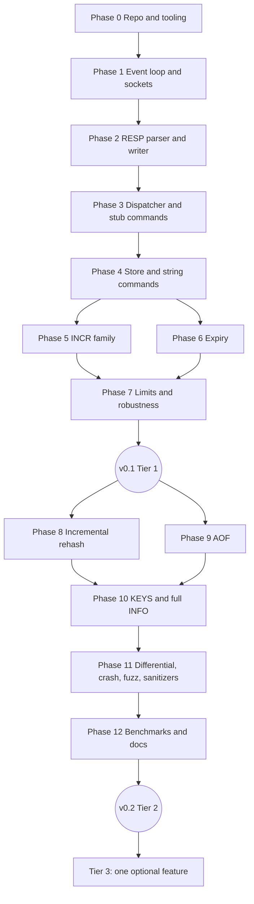

# KVForge — Implementation Plan

This plan turns the specification into an ordered build. Each phase has a goal, the files to create, the key details, the tests to write in the same phase, and an exit check. Do not start a phase until the previous exit check passes. Specs referenced: `PRD.md`, `architecture/SYSTEM_ARCHITECTURE.md`, `architecture/DATABASE_DESIGN.md`, `architecture/API_SPECIFICATION.md`, `ACCEPTANCE_CRITERIA.md`.

## 1. Dependency graph


## 2. Phase 0 — Repository and tooling
**Goal:** a repo that builds, formats and runs CI before any feature exists.
**Create:**
```
CMakeLists.txt  .clang-format  .clang-tidy  .gitignore  LICENSE  README.md (stub)
src/main.cpp (prints version)  src/util/log.hpp/.cpp  src/config/config.hpp/.cpp
tests/CMakeLists.txt  tests/unit/test_config.cpp
.github/workflows/ci.yml
```
**Details:**
- CMake options from `TECH_STACK.md` §3; targets: `kvforge_core` (static library with all modules), `kvforge` (executable), `kvforge_tests`.
- `log.hpp`: levels, timestamp in UTC ISO-8601 with milliseconds, format per `UI_SPECIFICATION.md` §3; writes to stderr.
- `config`: parse flags and config file per `UI_SPECIFICATION.md` §2; exact error messages from §2.4; `--help` golden text; `--version`.
- CI: build with GCC and Clang, run tests.
**Tests:** config parsing (valid, invalid, precedence, config file), `--help` golden file and 80-column check.
**Exit:** CI green on an empty feature set; `kvforge --help` matches the golden file.

## 3. Phase 1 — Event loop and sockets
**Goal:** accept many connections and echo bytes without blocking.
**Create:** `net/socket_util`, `net/listener`, `net/connection`, `net/event_loop`.
**Details:**
- Listener: `socket`, `SO_REUSEADDR`, `bind`, `listen(511)`, non-blocking; accept with `accept4(SOCK_NONBLOCK)`; set `TCP_NODELAY` and `SO_KEEPALIVE` on clients.
- Event loop per `SYSTEM_ARCHITECTURE.md` §5: `epoll_create1`, level-triggered; `signalfd` for `SIGINT`/`SIGTERM`; block those signals with `sigprocmask`; ignore `SIGPIPE`.
- Connection: read buffer, write buffer, `want_write` handling with `EPOLLOUT` on demand.
- Temporary echo handler: whatever is read is queued to the write buffer.
- Enforce `max_clients` with the `-ERR max number of clients reached` reply and close.
- Lower `max_clients` when `RLIMIT_NOFILE` is too small (warn).
**Tests:** integration test that starts the binary on an ephemeral port, connects 1,000 clients, echoes data, closes cleanly; SIGTERM exits with code 0; port-in-use exits with code 1 (AC-NET-01, AC-NET-02).
**Exit:** AC-NET-01, AC-NET-02 pass; no leaks under ASan; idle CPU below 1%.

## 4. Phase 2 — RESP parser and writer
**Goal:** correct, resumable protocol handling independent of sockets.
**Create:** `protocol/resp_parser`, `protocol/resp_writer`, `tests/unit/test_resp_parser.cpp`, `tests/fuzz/fuzz_resp_parser.cpp`.
**Details:**
- Parser API: `ParseResult parse(const char* data, size_t len, size_t& consumed, Command& out)` returning `Ok`, `NeedMore` or `Error{reason}`.
- Implement array-of-bulk and inline modes per `SYSTEM_ARCHITECTURE.md` §7; enforce all limits **before** allocating; digits-only length parsing with overflow checks.
- Writer: `simple`, `error`, `integer`, `bulk`, `null_bulk`, `array_header`, and an `append` into a `std::string` buffer.
- Wire up the parser in `on_readable`: parse loop, yield after 1,000 commands per iteration; protocol error → send error, `close_after_write`.
**Tests:**
- Table-driven valid and invalid inputs.
- Every split position of every valid sample (AC-PRO-02) and byte-at-a-time delivery (AC-PRO-01).
- Pipelined 10,000 commands (AC-PRO-03).
- Limit violations (AC-LIM-01, AC-LIM-02).
- Start the libFuzzer harness now (smoke run 60 s in CI).
**Exit:** all parser tests pass under ASan/UBSan; fuzzer finds nothing in 10 minutes.

## 5. Phase 3 — Dispatcher and stub commands
**Goal:** `redis-cli` connects and gets answers.
**Create:** `commands/command_table`, `commands/server_cmds.cpp` (PING, ECHO, COMMAND, CONFIG GET, CLIENT, INFO minimal).
**Details:**
- `CommandSpec` table with name, arity, handler, `is_write` (see `SYSTEM_ARCHITECTURE.md` §4 and §8).
- Unknown command and arity errors with exact text (`API_SPECIFICATION.md` §4).
- `COMMAND` → `*0`; `COMMAND COUNT` → integer; `CONFIG GET` for the supported parameters; `CLIENT SETNAME/SETINFO` → `+OK`.
- `ServerContext` and `Stats` created; `INFO` returns the Tier 1 fields.
**Tests:** AC-PING-01..04, AC-PRO-04..06, AC-SRV-03 (manual: `redis-cli` starts), `redis-benchmark -t ping -n 100000` runs.
**Exit:** `redis-cli -p 6380` interactive session works; `redis-benchmark -t ping` completes.

## 6. Phase 4 — Store and string commands
**Goal:** the core keyspace.
**Create:** `store/entry.hpp`, `store/hash_table`, `store/store`, `util/random.hpp` (seed via `getrandom`), `commands/string_cmds.cpp`, `commands/key_cmds.cpp` (partial).
**Details:**
- Hash table per `DATABASE_DESIGN.md` §3 with **full** (not yet incremental) resize for now, but keep the two-table structure and `rehash_step` API so Phase 8 only changes the policy.
- Hash function FNV-1a with seed and finalizer.
- Commands: `SET` (no expiry options yet; parse `NX`/`XX`), `GET`, `DEL`, `EXISTS`, `MSET`, `MGET`, `DBSIZE`, `FLUSHALL`.
- Stats: hits and misses; `used_memory` accounting.
**Tests:** unit tests for the hash table (insert 2,000,000 distinct keys, delete half, verify) and commands via an in-memory `ReplyWriter`; AC-SET-01..04, AC-SET-08, AC-SET-09, AC-GET-01, AC-DEL-01, AC-EXISTS-01, AC-MULTI-01..03, AC-SRV-01..02, AC-PRO-08, AC-HT-01.
**Exit:** all listed ACs pass; `redis-benchmark -t set,get -n 100000` completes.

## 7. Phase 5 — INCR family
**Create:** `util/int_parse.hpp` and the handlers.
**Details:**
- `parse_int64(string_view, int64_t&)`: canonical decimal only (optional `-`, no `+`, no leading zeros other than `0`, no spaces, at most 20 chars), overflow-safe.
- Overflow detection with `__builtin_add_overflow` (GCC/Clang) before assignment.
- Keep the existing TTL when updating the value.
**Tests:** AC-INCR-01..06, exhaustive boundary tests around `INT64_MIN` and `INT64_MAX`.
**Exit:** all AC-INCR pass.

## 8. Phase 6 — Expiry
**Create:** `expiry/expiry_index`, `util/clock.hpp` (injectable), expiry commands, `SET` options.
**Details:**
- `ctx.now_ms` updated once per loop iteration from `CLOCK_REALTIME`.
- Lazy expiry in `Store::lookup` (strictly `now_ms > expire_at_ms`).
- Min-heap with validation and rebuild rule (`DATABASE_DESIGN.md` §4).
- Active cycle with budget; `epoll_wait` timeout = min(100 ms, next deadline).
- Commands: `EXPIRE`, `PEXPIRE`, `PEXPIREAT`, `TTL` (nearest-second formula), `PTTL`, `PERSIST`; `SET` options `EX`, `PX`, `PXAT`.
**Tests:** AC-SET-05..07, AC-EXP-01..07 using the injectable clock for unit tests and real sleeps in a few integration tests.
**Exit:** all AC-EXP pass; idle CPU below 1%.

## 9. Phase 7 — Limits and robustness
**Details:**
- Output buffer limit and disconnect (AC-LIM-04); query buffer limit; per-iteration fairness cap; buffer shrinking.
- Graceful shutdown path (no AOF yet).
- Write the Tier 1 README quick start and verify AC-DOC-02 in a fresh container.
**Tests:** AC-LIM-01..04, AC-PRO-07, AC-PRO-09, a slow-reader test, a 10,000-pipeline test.
**Exit:** **Release v0.1** when all `[T1]` acceptance criteria pass and CI is green.

## 10. Phase 8 — Incremental rehashing
**Details:** switch `HashTable` to the incremental algorithm in `DATABASE_DESIGN.md` §3.3–3.4; add idle `rehash_step` in the loop; add `rehashing` to `INFO`.
**Tests:** AC-HT-02 (pause mid-rehash and verify every operation), AC-HT-03 (latency measurement test at 1,000,000 keys; report max pause), AC-HT-04; randomized model test comparing against `std::unordered_map` over 1,000,000 mixed operations.
**Exit:** AC-HT-01..04 pass; sanitizers clean.

## 11. Phase 9 — AOF
**Create:** `persistence/aof_writer`, `persistence/aof_loader`; handlers call `ctx.aof->append(...)` with normalized records.
**Details:**
- Normalization table in `DATABASE_DESIGN.md` §6.2; lazy and active expiry append `DEL`.
- `always`: hold replies for the batch until `fsync` returns (the connection's reply flush is deferred until the AOF sync step at the end of the loop iteration).
- `everysec`: `fsync` from the loop timer; `no`: never.
- Loader per §6.5: replay through the command table in replay mode (no re-append, no replies); truncate incomplete tail; fail on corruption with offset.
- Graceful shutdown flushes and fsyncs.
**Tests:** AC-AOF-01..07, `kill -9` test harness skeleton (Phase 11 completes it), replay equivalence test (random commands → AOF → restart → compare with model).
**Exit:** AC-AOF-01..07 pass.

## 12. Phase 10 — KEYS and complete INFO
**Details:** `KEYS` with glob subset (`util/glob`), skipping expired keys; all `INFO` sections and fields from `API_SPECIFICATION.md` §6; the log-line formats and rate-limited duplicate warnings from the UI spec.
**Tests:** AC-SRV-04, AC-INFO-01..02, AC-OBS-01, glob unit tests.
**Exit:** those ACs pass.

## 13. Phase 11 — Verification suites
**Create:** `tests/differential/`, `tests/crash/`, extended fuzzing, CI jobs.
**Details:** see `testing/TEST_PLAN.md` §6–§9. Differential generator, crash-recovery runner, AOF-loader fuzz harness, sanitizer job, coverage report.
**Exit:** AC-DIFF-01, AC-QUA-01..03 pass; every divergence from Redis is either fixed or listed under "Documented differences" in the README.

## 14. Phase 12 — Benchmarks and documentation
**Details:** `bench/run.sh` per `testing/TEST_PLAN.md` §10; run on native Linux/Azure VM; produce the report using the template in `design/UI_SPECIFICATION.md` §7; README completed per §8 of that document; ADRs finalized; known limitations written.
**Exit:** AC-BEN-01..03, AC-DOC-01..04 pass; **Release v0.2**.

## 15. Tier 3 (optional, only after v0.2)
Pick one option from `SCOPE.md` §4. Before starting: write a one-page design addendum (data structure, commands, tests, acceptance criteria) and add it to `docs/`. Do not begin Tier 3 if Tier 2 documentation is incomplete.

## 16. Working rules for every phase
1. Write the acceptance tests for the phase first (or alongside); a phase is done when its tests pass, not when the code compiles.
2. Keep each pull request small and tied to one phase and one concern.
3. Run the sanitizer build locally before pushing.
4. Update the traceability table (`testing/TEST_PLAN.md` §12) when a test is added.
5. If a spec statement turns out to be wrong, fix the spec in the same pull request and note it in the changelog.
6. Do not add features outside `SCOPE.md`.

## 17. Common pitfalls to avoid
| Pitfall | Prevention |
|---|---|
| Treating a short `read()` as a whole command | Always parse from the buffer; never assume packet boundaries |
| Forgetting `EPOLLOUT` handling, causing stuck replies | Integration test with a slow reader |
| Using relative TTLs in the AOF | Normalization table and the AC-AOF-03 test |
| Stale heap entries deleting live keys | Validate against the entry's current deadline (AC-EXP-06) |
| Allocating the declared bulk size up front | Grow with received bytes only |
| Reading the wall clock inside every command | Use `ctx.now_ms` for consistency and speed |
| Benchmarking with different persistence settings | The report template records persistence for both servers |
| Counting `WSL2` numbers as results | Benchmark only on native Linux or a Linux VM |