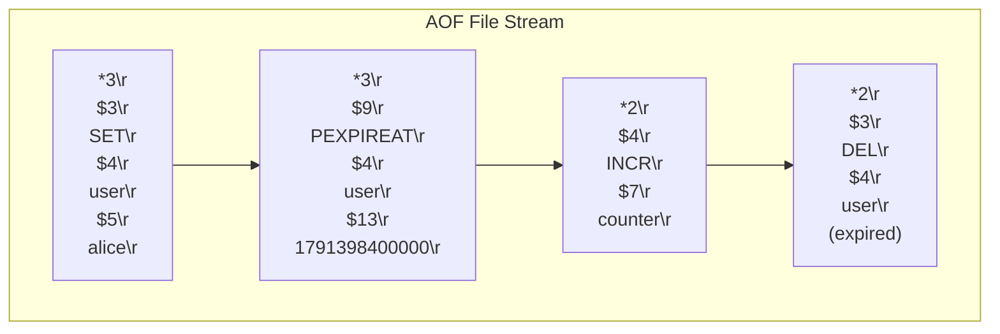

# KVForge — Backup and Recovery Specification

This document defines the backup procedures, recovery protocols, file integrity validation, and disaster recovery (DR) runbooks for KVForge. KVForge achieves data durability through an Append-Only File (AOF) persistence engine.

---

## 1. Durability Objectives (RPO & RTO)

| Metric | Target | Determinant |
|---|---|---|
| **Recovery Point Objective (RPO)** | **0 seconds** (`appendfsync always`)<br>$\le \mathbf{1\text{ second}}$ (`appendfsync everysec`)<br>$\sim \mathbf{30\text{ seconds}}$ (`appendfsync no`) | Dictated by the `--appendfsync` configuration parameter. Under `always`, every acknowledged write is committed via `fsync` before the reply is flushed to the network. |
| **Recovery Time Objective (RTO)** | **10 seconds per 1 GB of AOF** | Dictated by disk sequential read speed and single-threaded CPU replay rate (typically $\approx 100,000$ to $200,000$ commands/sec during replay). |

---

## 2. AOF Storage Mechanics & File Anatomy

### 2.1 File Characteristics
- **Default Path:** `/var/lib/kvforge/appendonly.aof`
- **File Permissions:** Created with mode `0600` (`-rw-------`, owner read/write only).
- **Format:** Strict, canonical RESP2 stream of write commands.
- **Normalization:** Commands written to the AOF are normalized at write time (e.g. relative TTLs `SET key val EX 10` are rewritten into absolute millisecond timestamps `PEXPIREAT key <abs_ms>`).
- **Deletions:** Explicit `DEL` commands, as well as lazy and active expiry reaps, append a `DEL` record to prevent key revival upon replay.



---

## 3. Backup Procedures

Because KVForge continually appends to `appendonly.aof`, backups can be taken without taking the server offline.

### 3.1 Hot / Live Backup Strategy
A hot backup involves capturing a consistent point-in-time copy of the active AOF:
1. **Fsync Synchronization:** If running with `appendfsync everysec`, the file is synced every second.
2. **Sequential Copying:** When copying an active append-only file, the target file will represent a consistent prefix of commands up to the moment the copy completed, with a potential partial record at the very tail.
3. **Tail Record Truncation Check:** A backup script must verify that the copied file ends on a valid RESP command boundary.

### 3.2 Automated Backup Script (`kvforge-backup.sh`)
Install this script at `/usr/local/bin/kvforge-backup.sh` (executable, owner `root:root`):

```bash
#!/usr/bin/env bash
set -euo pipefail

# Configuration
SOURCE_AOF="/var/lib/kvforge/appendonly.aof"
BACKUP_DIR="/var/backups/kvforge"
DATE_TAG=$(date -u +"%Y%m%d_%H%M%SZ")
ARCHIVE_NAME="kvforge_aof_${DATE_TAG}.tar.zst"
RETENTION_DAYS=7

mkdir -p "${BACKUP_DIR}"

if [ ! -f "${SOURCE_AOF}" ]; then
    echo "[ERROR] Source AOF file ${SOURCE_AOF} does not exist." >&2
    exit 1
fi

echo "[INFO] Starting KVForge live backup at $(date -u)"

# Create a temporary snapshot copy
TMP_COPY="${BACKUP_DIR}/tmp_snapshot_${DATE_TAG}.aof"
cp --sparse=always "${SOURCE_AOF}" "${TMP_COPY}"

# Verify file non-empty
if [ ! -s "${TMP_COPY}" ]; then
    echo "[ERROR] Snapshot copy is empty." >&2
    rm -f "${TMP_COPY}"
    exit 1
fi

# Compress using zstd for high speed and ratio
tar -C "${BACKUP_DIR}" -c "tmp_snapshot_${DATE_TAG}.aof" | zstd -T0 -3 > "${BACKUP_DIR}/${ARCHIVE_NAME}"
rm -f "${TMP_COPY}"

# Generate SHA-256 checksum
sha256sum "${BACKUP_DIR}/${ARCHIVE_NAME}" > "${BACKUP_DIR}/${ARCHIVE_NAME}.sha256"

# Secure permissions
chmod 600 "${BACKUP_DIR}/${ARCHIVE_NAME}"*
chown kvforge:kvforge "${BACKUP_DIR}/${ARCHIVE_NAME}"*

echo "[INFO] Backup saved to ${BACKUP_DIR}/${ARCHIVE_NAME}"

# Prune archives older than retention threshold
find "${BACKUP_DIR}" -name "kvforge_aof_*.tar.zst*" -type f -mtime +${RETENTION_DAYS} -delete

echo "[INFO] Backup completed successfully."
```

Configure a systemd timer or cron job to run this script every 6 hours:
```cron
0 */6 * * * /usr/local/bin/kvforge-backup.sh >> /var/log/kvforge/backup.log 2>&1
```

---

## 4. Disaster Recovery & Restoration Runbook

### 4.1 Standard Full Restore Procedure
To restore a database from an archived backup:

1. **Stop the KVForge Service:**
   ```bash
   sudo systemctl stop kvforge
   ```

2. **Quarantine the Current Data Directory:**
   ```bash
   sudo mv /var/lib/kvforge/appendonly.aof /var/lib/kvforge/appendonly.aof.broken.$(date +%s) || true
   ```

3. **Extract and Verify the Backup Archive:**
   ```bash
   BACKUP_ARCHIVE="/var/backups/kvforge/kvforge_aof_20261007_120000Z.tar.zst"
   
   # Verify SHA-256
   sha256sum -c "${BACKUP_ARCHIVE}.sha256"
   
   # Extract to /var/lib/kvforge
   sudo tar -I zstd -xvf "${BACKUP_ARCHIVE}" -C /var/lib/kvforge/
   sudo mv /var/lib/kvforge/tmp_snapshot_*.aof /var/lib/kvforge/appendonly.aof
   ```

4. **Verify Ownership & File Permissions:**
   ```bash
   sudo chown kvforge:kvforge /var/lib/kvforge/appendonly.aof
   sudo chmod 0600 /var/lib/kvforge/appendonly.aof
   ```

5. **Start KVForge & Monitor Replay:**
   ```bash
   sudo systemctl start kvforge
   sudo journalctl -u kvforge -f
   ```

6. **Validate Keyspace State:**
   ```bash
   redis-cli -p 6380 DBSIZE
   redis-cli -p 6380 INFO keyspace
   ```

---

## 5. Corruption Repair & Truncation Handling

KVForge has strictly defined behaviors for encountering damaged AOF files at startup:

### 5.1 Tail Truncation (Incomplete Last Record)
- **Scenario:** The host crashed or lost power while the server was executing an `append()` syscall, leaving a truncated RESP command at the end of the file.
- **Engine Behavior (AC-AOF-05):** At startup, the loader detects the trailing partial command, truncates the file back to the preceding clean command boundary, logs a prominent warning (`[WARN] [aof] Incomplete record at end of AOF file; truncated N bytes`), and successfully boots.

### 5.2 Mid-File Corruption (Non-Recoverable)
- **Scenario:** Bit-rot, hardware storage failure, or unauthorized tampering modifies bytes in the middle of the AOF file.
- **Engine Behavior (AC-AOF-06):** At startup, the loader fails immediately with an error log:
  ```
  [ERROR] [aof] Corrupt AOF record at byte offset 49152: invalid RESP prefix. Server refusing to start.
  ```
  KVForge exits with code 1. **It will never perform "best-effort" recovery that skips corrupt middle bytes**, as doing so would cause silent keyspace divergence.

### 5.3 Manual Repair Procedure for Mid-File Corruption
If middle corruption occurs and no clean backup exists, an operator can inspect and repair the file:
```bash
# Locate the corruption offset from logs
OFFSET=49152

# Make a working copy
cp /var/lib/kvforge/appendonly.aof /var/lib/kvforge/appendonly.aof.bak

# Inspect bytes around the failure point
xxd -s $((OFFSET - 64)) -l 128 /var/lib/kvforge/appendonly.aof

# If truncating at this offset is acceptable:
truncate -s ${OFFSET} /var/lib/kvforge/appendonly.aof
```

---

## 6. Disk Full & AOF Write Failures

### 6.1 Server Behavior on Write Failures
When the underlying disk volume runs out of free space or encounters an I/O error during an `append()` or `fsync()` syscall:
1. The error is logged to `stderr`: `[ERROR] [aof] Failed writing to AOF: No space left on device`.
2. `INFO persistence` updates `aof_last_write_status` from `ok` to `err`.
3. **Protective Write Lockout:** To prevent RAM and disk from diverging, all incoming write commands (`SET`, `DEL`, `INCR`, `FLUSHALL`) immediately fail with the error:
   ```
   -MISCONF Errors writing to the append-only file (disk full or write error)
   ```
4. Read commands (`GET`, `MGET`, `EXISTS`, `PING`, `INFO`) continue to be served normally.

### 6.2 Operator Remediation
1. Expand the disk volume or clean up old logs / archives in `/var/log` or `/tmp`.
2. Verify disk space using `df -h /var/lib/kvforge`.
3. Once disk capacity is freed, the next successful loop flush resets `aof_last_write_status:ok`, and write commands resume automatically without requiring a process restart.

---

## 7. AOF Maintenance & Compaction

In Tier 1 and Tier 2, KVForge operates purely in append-only mode without in-memory background fork rewrite (ADR-004). Over prolonged execution, the file grows monotonically.

### 7.1 Maintenance Window Compaction
To compact an oversized AOF file during a scheduled maintenance window:
```bash
# 1. Connect and export all live keys into a clean state
redis-cli -p 6380 --scan | while read -r key; do
  ttl=$(redis-cli -p 6380 PTTL "$key")
  val=$(redis-cli -p 6380 GET "$key")
  # Generate clean SET commands
done > clean_dump.txt

# 2. Stop KVForge, replace AOF with compacted stream, and restart
```
*(Tier 3 Option C specifies the future implementation of background fork-based AOF rewrite).*

---

## 8. Disaster Recovery Testing Schedule

To ensure backup viability, run the following drills:
- **Weekly Automated Test:** A scheduled CI or staging job downloads the latest production backup, launches `kvforge --appendfilename <backup.aof>`, and executes `redis-cli DBSIZE` to verify replay completion.
- **Quarterly Tabletop Simulation:** Simulate host failure and execute manual restoration runbook from scratch.
