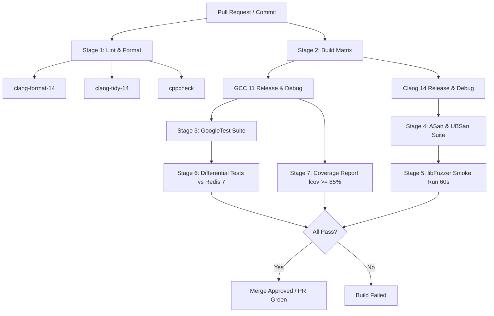

# KVForge — CI/CD Pipeline Specification

This document defines the continuous integration (CI) and continuous delivery (CD) architecture for KVForge. All commits, pull requests, and releases are validated through automated GitHub Actions pipelines to ensure correctness, memory safety, protocol compatibility, and zero build warnings.

---

## 1. Pipeline Principles & Quality Gates

The KVForge CI/CD pipeline enforces the following strict rules:
1. **Zero Compiler Warnings:** All builds compile with `-Wall -Wextra -Wpedantic -Werror`. Any warning fails the pipeline.
2. **Dual-Toolchain Support:** Every pull request must build and pass unit tests under both GCC (11+) and Clang (14+).
3. **Memory Safety & Undefined Behavior Verification:** All unit, integration, and protocol tests must pass cleanly under AddressSanitizer (ASan) and UndefinedBehaviorSanitizer (UBSan).
4. **Differential Conformance Gate:** 10,000 randomized command sequences run against KVForge and reference Redis 7.x; zero unexplained mismatches are tolerated.
5. **Coverage Floor:** Core modules (RESP parser, HashTable, ExpiryIndex, AOF engine) must achieve $\ge 85\%$ statement coverage.
6. **Reproducible Release Assets:** Tagged releases produce statically linked Linux x86-64 binaries with SHA-256 checksums.

---

## 2. Environment & Dependency Specifications

### 2.1 Runner Environment
- **Host OS:** `ubuntu-22.04` (GitHub Actions standard hosted runner).
- **Compilers:** GCC 11 & GCC 12; Clang 14 & Clang 15.
- **Build System:** CMake 3.22+, Ninja build tool.
- **Testing Framework:** GoogleTest 1.14+ (fetched via CMake `FetchContent`).

### 2.2 Redis Reference Version (Ubuntu 22.04 Note)
> **CRITICAL OPERATIONAL NOTE:** Ubuntu 22.04 LTS includes `redis-server` version 6.0.x in its default apt repositories. However, KVForge's differential tests, command behaviors, and baseline benchmarks specify **Redis 7.x**. 
> The CI runner must therefore configure the official `packages.redis.io` repository to install `redis-server` 7.x rather than using the default Ubuntu 6.0.x package.

---

## 3. Pipeline Stages & Matrix



### 3.1 Stage Summary
| Stage | Tool / Runner | Command / Target | Timeout | Blocker? |
|---|---|---|---|---|
| **Format** | `clang-format-14` | `git-clang-format --diff origin/main` | 2 min | Yes |
| **Static Analysis** | `clang-tidy-14` | Selected checks (`bugprone-*`, `modernize-*`) | 10 min | Yes |
| **Build GCC** | GCC 11 & 12 | `cmake --build build -j$(nproc)` | 5 min | Yes |
| **Build Clang** | Clang 14 & 15 | `cmake --build build -j$(nproc)` | 5 min | Yes |
| **Unit Tests** | CTest / GoogleTest | `ctest --output-on-failure -j$(nproc)` | 5 min | Yes |
| **Sanitizers** | ASan + UBSan | Full test suite under `-fsanitize=address,undefined` | 10 min | Yes |
| **Fuzz Smoke** | libFuzzer (Clang) | `fuzz_resp_parser -max_total_time=60` | 5 min | Yes |
| **Differential** | Python 3.10 + Redis 7 | `python3 tests/differential/run_diff.py --commands 10000` | 10 min | Yes |
| **Code Coverage** | `gcov` / `lcov` | Generate HTML & evaluate threshold | 5 min | Yes |

---

## 4. GitHub Actions CI Workflow (`.github/workflows/ci.yml`)

The primary workflow executed on pull requests and commits to `main`:

```yaml
name: KVForge CI

on:
  push:
    branches: [ main ]
  pull_request:
    branches: [ main ]

concurrency:
  group: ${{ github.workflow }}-${{ github.ref }}
  cancel-in-progress: true

jobs:
  lint-and-format:
    name: Code Quality & Lint
    runs-on: ubuntu-22.04
    steps:
      - name: Checkout code
        uses: actions/checkout@v4
        with:
          fetch-depth: 0

      - name: Install Lint Tools
        run: |
          sudo apt-get update
          sudo apt-get install -y clang-format-14 clang-tidy-14 cppcheck

      - name: Verify Formatting (clang-format)
        run: |
          find src tests -name '*.cpp' -o -name '*.hpp' | xargs clang-format-14 --dry-run --Werror

      - name: Static Analysis (cppcheck)
        run: |
          cppcheck --enable=warning,performance,portability \
                   --error-exitcode=1 \
                   --inline-suppr \
                   src/

  build-and-test:
    name: Build & Test (${{ matrix.compiler }}, ${{ matrix.build_type }})
    runs-on: ubuntu-22.04
    needs: lint-and-format
    strategy:
      fail-fast: false
      matrix:
        compiler: [ gcc-11, clang-14 ]
        build_type: [ Debug, Release ]

    steps:
      - name: Checkout code
        uses: actions/checkout@v4

      - name: Install Toolchain
        run: |
          sudo apt-get update
          if [ "${{ matrix.compiler }}" = "gcc-11" ]; then
            sudo apt-get install -y gcc-11 g++-11 cmake ninja-build
            echo "CC=gcc-11" >> $GITHUB_ENV
            echo "CXX=g++-11" >> $GITHUB_ENV
          else
            sudo apt-get install -y clang-14 lld-14 cmake ninja-build
            echo "CC=clang-14" >> $GITHUB_ENV
            echo "CXX=clang++-14" >> $GITHUB_ENV
          fi

      - name: Configure CMake
        run: |
          cmake -B build -G Ninja \
            -DCMAKE_BUILD_TYPE=${{ matrix.build_type }} \
            -DKVFORGE_BUILD_TESTS=ON \
            -DCMAKE_EXPORT_COMPILE_COMMANDS=ON

      - name: Build Targets
        run: cmake --build build

      - name: Execute Tests
        run: |
          ctest --test-dir build --output-on-failure -j$(nproc)

  sanitizers:
    name: Address & UndefinedBehavior Sanitizers
    runs-on: ubuntu-22.04
    needs: lint-and-format
    steps:
      - name: Checkout code
        uses: actions/checkout@v4

      - name: Install Clang & Ninja
        run: |
          sudo apt-get update
          sudo apt-get install -y clang-14 lld-14 cmake ninja-build

      - name: Configure CMake with Sanitizers
        env:
          CC: clang-14
          CXX: clang++-14
        run: |
          cmake -B build-asan -G Ninja \
            -DCMAKE_BUILD_TYPE=Debug \
            -DKVFORGE_BUILD_TESTS=ON \
            -DKVFORGE_SANITIZE=ON

      - name: Build Sanitized Targets
        run: cmake --build build-asan

      - name: Run Tests under ASan/UBSan
        env:
          ASAN_OPTIONS: "detect_leaks=1:abort_on_error=1:detect_stack_use_after_return=1"
          UBSAN_OPTIONS: "halt_on_error=1:print_stacktrace=1"
        run: |
          ctest --test-dir build-asan --output-on-failure -j$(nproc)

  fuzz-smoke:
    name: libFuzzer Smoke Run (60s)
    runs-on: ubuntu-22.04
    needs: lint-and-format
    steps:
      - name: Checkout code
        uses: actions/checkout@v4

      - name: Install Clang
        run: |
          sudo apt-get update
          sudo apt-get install -y clang-14 cmake ninja-build

      - name: Build Fuzz Targets
        env:
          CC: clang-14
          CXX: clang++-14
        run: |
          cmake -B build-fuzz -G Ninja \
            -DCMAKE_BUILD_TYPE=Release \
            -DKVFORGE_BUILD_FUZZ=ON
          cmake --build build-fuzz --target fuzz_resp_parser fuzz_aof_loader

      - name: Run RESP Parser Fuzzer
        run: |
          ./build-fuzz/tests/fuzz/fuzz_resp_parser -max_total_time=60 -verbosity=0

      - name: Run AOF Loader Fuzzer
        run: |
          ./build-fuzz/tests/fuzz/fuzz_aof_loader -max_total_time=30 -verbosity=0

  differential-test:
    name: Differential Testing vs Redis 7
    runs-on: ubuntu-22.04
    needs: [ build-and-test, sanitizers ]
    steps:
      - name: Checkout code
        uses: actions/checkout@v4

      - name: Install Python & Redis 7.x
        run: |
          sudo apt-get update
          sudo apt-get install -y curl gpg lsb-release python3-pip
          # Install official Redis 7.x package repository (avoiding default 6.0.x on Ubuntu 22.04)
          curl -fsSL https://packages.redis.io/gpg | sudo gpg --dearmor -o /usr/share/keyrings/redis-archive-keyring.gpg
          echo "deb [signed-by=/usr/share/keyrings/redis-archive-keyring.gpg] https://packages.redis.io/deb $(lsb_release -cs) main" | sudo tee /etc/apt/sources.list.d/redis.list
          sudo apt-get update
          sudo apt-get install -y redis-server redis-tools
          pip3 install redis pytest

      - name: Verify Redis Version
        run: |
          redis-server --version | grep -E "v=7\."

      - name: Build KVForge Release
        run: |
          cmake -B build-rel -DCMAKE_BUILD_TYPE=Release
          cmake --build build-rel --target kvforge

      - name: Run Differential Test Suite (10,000 Commands)
        run: |
          python3 tests/differential/test_diff.py \
            --kvforge-bin ./build-rel/src/kvforge \
            --redis-server /usr/bin/redis-server \
            --iterations 10000 \
            --seed 42

  coverage:
    name: Code Coverage Analysis
    runs-on: ubuntu-22.04
    needs: build-and-test
    steps:
      - name: Checkout code
        uses: actions/checkout@v4

      - name: Install LCOV
        run: sudo apt-get update && sudo apt-get install -y lcov gcc-11 g++-11

      - name: Build with Coverage
        env:
          CC: gcc-11
          CXX: g++-11
        run: |
          cmake -B build-cov \
            -DCMAKE_BUILD_TYPE=Debug \
            -DKVFORGE_BUILD_TESTS=ON \
            -DCMAKE_CXX_FLAGS="--coverage"
          cmake --build build-cov

      - name: Execute Tests
        run: ctest --test-dir build-cov --output-on-failure

      - name: Collect Coverage & Enforce 85% Threshold
        run: |
          lcov --capture --directory build-cov --output-file coverage.info
          lcov --remove coverage.info '/usr/*' '*/tests/*' '*/_deps/*' --output-file coverage_filtered.info
          lcov --list coverage_filtered.info
          # Verify minimum 85% line coverage
          python3 -c "
          import re, sys
          with open('coverage_filtered.info') as f:
              lines = f.readlines()
          hit = sum(1 for l in lines if l.startswith('DA:') and not l.endswith(',0\n'))
          total = sum(1 for l in lines if l.startswith('DA:'))
          cov = (hit / total) * 100 if total > 0 else 0
          print(f'Overall Line Coverage: {cov:.2f}%')
          if cov < 85.0:
              sys.exit(f'Coverage {cov:.2f}% is below required 85.0% floor')
          "
```

---

## 5. Release Automation Workflow (`.github/workflows/release.yml`)

The CD pipeline triggered upon publishing a git tag (`v*.*.*`):

```yaml
name: KVForge Release Delivery

on:
  push:
    tags:
      - 'v*.*.*'

jobs:
  build-release-binaries:
    name: Build Static Binary Asset
    runs-on: ubuntu-22.04
    steps:
      - name: Checkout code
        uses: actions/checkout@v4

      - name: Install Dependencies
        run: |
          sudo apt-get update
          sudo apt-get install -y cmake ninja-build g++-11

      - name: Build Release Binary
        run: |
          cmake -B build-release -G Ninja \
            -DCMAKE_BUILD_TYPE=Release \
            -DKVFORGE_BUILD_TESTS=OFF \
            -DCMAKE_CXX_FLAGS="-O2 -DNDEBUG -fno-plt -static-libgcc -static-libstdc++"
          cmake --build build-release
          strip build-release/src/kvforge

      - name: Package Binary & Checksums
        run: |
          mkdir -p dist
          TAG=${GITHUB_REF#refs/tags/}
          PKG_NAME="kvforge-${TAG}-linux-x86_64"
          mkdir "${PKG_NAME}"
          cp build-release/src/kvforge "${PKG_NAME}/"
          cp README.md LICENSE "${PKG_NAME}/"
          tar -czvf "dist/${PKG_NAME}.tar.gz" "${PKG_NAME}"
          cd dist
          sha256sum "${PKG_NAME}.tar.gz" > SHA256SUMS
          cat SHA256SUMS

      - name: Publish GitHub Release
        uses: softprops/action-gh-release@v1
        with:
          files: |
            dist/*.tar.gz
            dist/SHA256SUMS
          draft: false
          prerelease: false
          generate_release_notes: true
```

---

## 6. Failure Remediation & Flaky Test Policy

- **Flaky Tests:** Zero tolerance. If a test fails nondeterministically in CI (e.g., race conditions on socket teardown or clock synchronization), it must either be fixed immediately or quarantined into an issue branch.
- **Sanitizer Failures:** Any report from ASan, LSan, or UBSan halts merging. Suppressions are prohibited without an approved Architecture Decision Record (ADR).
- **Differential Deviations:** If Redis 7 and KVForge produce differing replies, the discrepancy must either be resolved or explicitly declared in `docs/COMPATIBILITY.md` and registered in `compat_exclusions.json`.
