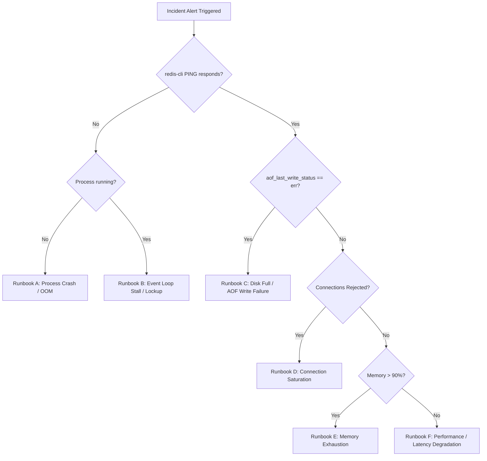

# KVForge — Incident Response Runbook

This runbook defines emergency procedures, severity definitions, diagnosis workflows, and remediation protocols for production incidents involving KVForge.

---

## 1. Incident Classification & Severity Levels

| Severity | Criteria | Impact | Response Time (SLA) |
|---|---|---|---|
| **SEV-1** (Critical) | • KVForge process crashed or unresponsive to `PING`<br>• AOF persistence write failure (`aof_last_write_status: err`)<br>• Data loss or corruption detected | Complete outage or writes blocked across client services | $\le 15\text{ minutes}$ |
| **SEV-2** (Major) | • p99 latency $> 10\text{ ms}$ on core commands<br>• Client connection rejections (`rejected_connections > 0`)<br>• Memory usage $> 85\%$ of host capacity | Significant latency degradation or intermittent client errors | $\le 30\text{ minutes}$ |
| **SEV-3** (Minor) | • Slow client buffer disconnects occurring<br>• High rate of protocol error logs<br>• Extended hash table rehashing | Low impact; localized client issues | Next business day / $\le 4\text{ hours}$ |

---

## 2. Emergency Triage Decision Tree



---

## 3. Incident Remediation Runbooks

### 3.1 Runbook A: Server Crash or Process Exit
**Symptoms:** `redis-cli PING` fails with `Connection refused`. Systemd status reports `failed` or `inactive`.

**Diagnostic Steps:**
1. Check process exit status via systemd:
   ```bash
   systemctl status kvforge
   ```
2. Inspect the tail of the journal for fatal signals:
   ```bash
   journalctl -u kvforge -n 100 --no-pager
   ```
3. Check if the Linux kernel Out-Of-Memory (OOM) killer terminated the process:
   ```bash
   sudo dmesg -T | grep -E -i "killed process.*kvforge|oom_reaper"
   ```
4. Check for generated coredumps:
   ```bash
   coredumpctl list kvforge
   ```

**Remediation:**
- **If killed by OOM:** The dataset exceeded physical RAM. Temporarily increase host swap, restart the service, and verify memory usage via `INFO memory`. Plan vertical scaling.
- **If killed by SIGSEGV / SIGABRT:** Inspect the core dump:
  ```bash
  coredumpctl gdb kvforge -A "-ex bt -ex quit"
  ```
  File a critical bug report with the stack trace. Restart the service to restore availability:
  ```bash
  sudo systemctl restart kvforge
  ```

---

### 3.2 Runbook B: Event Loop Stall / High Latency
**Symptoms:** `PING` times out or takes $> 1\text{ second}$. Latency spikes across all client applications.

**Root Causes in Single-Threaded Architecture:**
1. An operator or batch script executed `KEYS *` over a large keyspace.
2. Huge multibulk command pipelining.
3. Excessive single-key bulk payload transfer.
4. Incremental rehashing collision spike.

**Diagnostic Steps:**
1. Check current connected clients and their running commands:
   ```bash
   redis-cli -p 6380 CLIENT LIST
   ```
2. Trace what system call the thread is currently executing:
   ```bash
   sudo strace -p $(pgrep -f kvforge) -c -T -f
   ```
3. Check CPU usage:
   ```bash
   top -p $(pgrep -f kvforge)
   ```

**Remediation:**
- If an abusive client is running `KEYS *` or huge requests, identify the client's file descriptor or IP from `CLIENT LIST`. If external proxy allows, terminate the offending connection immediately.
- Advise development teams to replace `KEYS` with targeted key lookups.

---

### 3.3 Runbook C: Disk Full & AOF Write Failure
**Symptoms:** Clients report `-MISCONF Errors writing to the append-only file (disk full or write error)`. Writes (`SET`, `DEL`) are rejected.

**Diagnostic Steps:**
1. Verify persistence status via `INFO`:
   ```bash
   redis-cli -p 6380 INFO persistence | grep aof_last_write_status
   # Shows: aof_last_write_status:err
   ```
2. Check disk space on the partition housing the AOF file:
   ```bash
   df -h /var/lib/kvforge
   ```
3. Check filesystem inodes:
   ```bash
   df -i /var/lib/kvforge
   ```

**Remediation:**
1. Free up disk space on the volume (prune old backups in `/var/backups`, remove rotated system logs in `/var/log`).
2. Verify available space is $> 1\text{ GB}$.
3. Once disk space is available, KVForge will automatically recover on the next loop iteration:
   ```bash
   redis-cli -p 6380 SET test_probe ok
   # Expected: +OK
   ```
4. Verify `aof_last_write_status` returns to `ok`.

---

### 3.4 Runbook D: Connection Saturation & Max Clients Reached
**Symptoms:** New client connection attempts fail with `-ERR max number of clients reached` or connection drops.

**Diagnostic Steps:**
1. Query connected clients count:
   ```bash
   redis-cli -p 6380 INFO clients
   ```
2. Check current open file descriptors:
   ```bash
   ls /proc/$(pgrep -f kvforge)/fd | wc -l
   ```
3. Inspect client connection sources to locate connection leaks:
   ```bash
   redis-cli -p 6380 CLIENT LIST | awk '{print $2}' | sort | uniq -c | sort -nr | head -n 20
   ```

**Remediation:**
1. Identify applications opening connections without closing them or pooling improperly.
2. If genuine traffic has grown, raise `maxclients` in `/etc/kvforge/kvforge.conf` and update `LimitNOFILE` in `/etc/systemd/system/kvforge.service`.
3. Restart or reload the service.

---

### 3.5 Runbook E: Memory Exhaustion Threat
**Symptoms:** `used_memory` approaches host limits. Risk of system OOM killer invocation.

**Diagnostic Steps:**
1. Check memory statistics:
   ```bash
   redis-cli -p 6380 INFO memory
   ```
2. Check keyspace size:
   ```bash
   redis-cli -p 6380 DBSIZE
   ```

**Remediation:**
1. Identify if non-expiring keys are filling RAM (compare `keys` vs `expires` in `INFO keyspace`).
2. If temporary cache keys were stored without TTLs, run an emergency script to apply expirations using `EXPIRE` or prune stale keys using `DEL`.
3. If necessary, execute an emergency memory flush (only if data is ephemeral cache):
   ```bash
   redis-cli -p 6380 FLUSHALL
   ```

---

## 4. Live Diagnostic Cheat-Sheet

```bash
# 1. Quick Health Probe
redis-cli -p 6380 PING

# 2. Extract Complete Telemetry
redis-cli -p 6380 INFO all

# 3. List Top Connected Clients
redis-cli -p 6380 CLIENT LIST

# 4. Kernel Socket Buffer Status
ss -t -i 'sport = :6380'

# 5. Live Syscall Profiling (5 seconds)
sudo perf top -p $(pgrep -f kvforge)

# 6. Read Systemd Logs with Timestamps
sudo journalctl -u kvforge -n 200 --no-pager
```

---

## 5. Post-Mortem & Incident Review Process

Following any SEV-1 or SEV-2 incident, a blameless post-mortem must be conducted within 48 hours.

### Post-Mortem Report Structure
1. **Summary:** Brief description of the incident, duration, and customer impact.
2. **Timeline:** Chronological breakdown of events (Trigger $\rightarrow$ Detection $\rightarrow$ Triage $\rightarrow$ Mitigation $\rightarrow$ Recovery).
3. **Root Cause Analysis (5 Whys):** Thorough investigation into systemic causes rather than individual human error.
4. **Resolution & Recovery:** Specific actions that restored normal operation.
5. **Action Items (Preventative Measures):** Assigned engineering tasks with deadlines to prevent recurrence (e.g. adding alert rules, updating limits, patching code).
