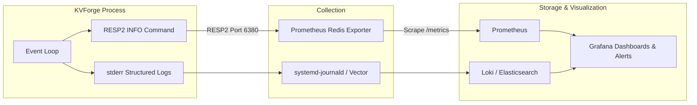

# KVForge — Monitoring & Observability Specification

This document defines the monitoring, metrics, logging, and observability architecture for KVForge in production. KVForge exposes internal runtime telemetry via standard Redis RESP2 commands (`INFO`) and emits structured operational logs to standard error.

---

## 1. Observability Overview

KVForge is designed to be monitored using industry-standard cloud-native observability tooling without requiring custom agent binaries:
- **Metrics:** Exposed over the network protocol via the `INFO` command. Scraped by Prometheus using standard Redis exporters.
- **Logs:** Structured, timestamped (UTC ISO-8601 with milliseconds), single-line log entries written to `stderr` and collected by systemd-journald, Vector, or Promtail.
- **Host Metrics:** CPU, memory, socket buffers, and disk I/O tracked via `node_exporter` or cAdvisor.



---

## 2. Telemetry via the `INFO` Command

KVForge implements the Redis-compatible `INFO` command with standard sections.

### 2.1 Core Sections & Key Telemetry Metrics
| Section | Key Metric | Type | Meaning / Purpose |
|---|---|---|---|
| `# Server` | `kvforge_version` | String | Deployed server version |
| | `uptime_in_seconds` | Counter | Total process uptime |
| | `process_id` | Gauge | Linux PID of running server |
| `# Clients` | `connected_clients` | Gauge | Active TCP client connections |
| | `blocked_clients` | Gauge | Always `0` in Tier 1/2 (non-blocking) |
| | `rejected_connections` | Counter | Count of connections rejected due to `maxclients` or FD exhaustion |
| `# Memory` | `used_memory` | Gauge | In-memory bytes tracked for keys, values, and table metadata |
| | `used_memory_human` | String | Human-readable representation (e.g. `14.20M`) |
| | `used_memory_rss` | Gauge | Resident Set Size (RSS) queried from `/proc/self/statm` |
| `# Persistence`| `aof_enabled` | Flag | `1` if append-only file persistence is enabled; otherwise `0` |
| | `aof_current_size` | Gauge | Size of `appendonly.aof` in bytes |
| | `aof_last_write_status` | String | `ok` or `err` (triggers alert if `err`) |
| | `aof_delayed_fsync` | Counter | Number of times fsync was delayed or stalled |
| `# Stats` | `total_connections_received`| Counter | Cumulative accepted connections since start |
| | `total_commands_processed` | Counter | Cumulative commands parsed and executed |
| | `instantaneous_ops_per_sec` | Gauge | Moving average commands processed per second |
| | `keyspace_hits` | Counter | Key lookups that returned an existing, non-expired key |
| | `keyspace_misses` | Counter | Key lookups that returned non-existent or expired keys |
| | `expired_keys` | Counter | Cumulative keys reaped via lazy and active expiry |
| `# CPU` | `used_cpu_sys` | Counter | Cumulative system CPU time in seconds |
| | `used_cpu_user` | Counter | Cumulative user CPU time in seconds |
| `# Keyspace`| `db0:keys=N,expires=M` | Gauges | Total keys and count of keys with active TTL |
| `# Internal` | `rehashing` | Flag | `1` if incremental hash-table resize is active; otherwise `0` |

---

## 3. Prometheus Exporter Integration

Because KVForge adheres strictly to RESP2 and implements standard `INFO` fields, it is compatible with the standard **Redis Prometheus Exporter** (`oliver006/redis_exporter`).

### 3.1 Exporter Deployment (Sidecar or Service)
```bash
# Run Prometheus redis_exporter pointing to KVForge port 6380
redis_exporter \
  -redis.addr="127.0.0.1:6380" \
  -web.listen-address=":9121" \
  -check.keys="db0"
```

### 3.2 Prometheus Scrape Configuration (`prometheus.yml`)
```yaml
scrape_configs:
  - job_name: 'kvforge'
    static_configs:
      - targets: ['127.0.0.1:9121']
        labels:
          service: 'kvforge-cache'
          environment: 'production'
```

---

## 4. Key Performance Indicators & Golden Signals

Operators should track the Four Golden Signals for KVForge:

### 4.1 Latency
- **Indicator:** Command processing and round-trip response time.
- **Threshold:** p99 latency should stay $< 2.0\text{ ms}$ under sustained load.
- **Risks:** The single-threaded event loop can be stalled by running `KEYS *` on a large keyspace or heavy incremental rehash cycles under severe memory pressure.

### 4.2 Traffic
- **Indicator:** `instantaneous_ops_per_sec` and rate of `total_commands_processed`.
- **Baseline:** Monitor baseline queries-per-second (QPS). Drops or spikes indicate application-side connection pool issues or cascading failures.

### 4.3 Errors
- **Indicator:** 
  - `aof_last_write_status != ok` (Disk full or permission failure).
  - Rate of `rejected_connections > 0` (Connection limit reached).
  - Application-side `-ERR` response rates.

### 4.4 Saturation
- **Indicator:**
  - `connected_clients / maxclients` percentage.
  - `used_memory` vs host memory limit.
  - CPU usage of the single KVForge process ($> 90\%$ single-core indicates CPU bound).
  - Open file descriptors vs `RLIMIT_NOFILE`.

---

## 5. Prometheus Alerting Rules (`kvforge_alerts.yml`)

Install these rules on the Prometheus server or Alertmanager:

```yaml
groups:
  - name: kvforge.alerts
    rules:
      - alert: KVForgeDown
        expr: redis_up{service="kvforge-cache"} == 0
        for: 30s
        labels:
          severity: critical
        annotations:
          summary: "KVForge instance is down"
          description: "KVForge instance at {{ $labels.instance }} has stopped responding to PING."

      - alert: KVForgeAOFWriteFailure
        expr: redis_aof_last_write_status{service="kvforge-cache"} != 1
        for: 15s
        labels:
          severity: critical
        annotations:
          summary: "KVForge AOF persistence write failure"
          description: "KVForge at {{ $labels.instance }} failed to write to AOF file (possible disk full or I/O error)."

      - alert: KVForgeHighMemoryUsage
        expr: redis_memory_used_bytes{service="kvforge-cache"} > 0.85 * (1024 * 1024 * 1024 * 8) # e.g. 8 GiB limit
        for: 2m
        labels:
          severity: warning
        annotations:
          summary: "KVForge memory saturation approaching limit"
          description: "Memory usage has exceeded 85% of allocated host threshold."

      - alert: KVForgeConnectionSaturation
        expr: redis_connected_clients{service="kvforge-cache"} / redis_config_maxclients{service="kvforge-cache"} > 0.80
        for: 1m
        labels:
          severity: warning
        annotations:
          summary: "KVForge client connections near capacity"
          description: "Connected clients count ({{ $value }}) is above 80% of maxclients."

      - alert: KVForgeRejectedConnections
        expr: increase(redis_rejected_connections_total{service="kvforge-cache"}[1m]) > 0
        for: 30s
        labels:
          severity: critical
        annotations:
          summary: "KVForge is rejecting client connections"
          description: "Client connections are being dropped due to maxclients limit or FD exhaustion."

      - alert: KVForgeHighRehashDuration
        expr: redis_rehashing{service="kvforge-cache"} == 1
        for: 10m
        labels:
          severity: info
        annotations:
          summary: "KVForge extended table rehashing"
          description: "Incremental rehashing has been active continuously for over 10 minutes."
```

---

## 6. Structured Logging Specification

### 6.1 Log Format
KVForge outputs single-line structured messages to `stderr` formatted as:
```
[TIMESTAMP] [LEVEL] [COMPONENT] message [key=value ...]
```
Example:
```
[2026-10-07T17:30:00.123Z] [INFO] [server] Ready to accept connections port=6380 pid=14022
[2026-10-07T17:30:15.842Z] [WARN] [net] Connection rejected: maxclients reached client_ip=127.0.0.1
[2026-10-07T17:30:45.001Z] [ERROR] [aof] Failed to append command to AOF: No space left on device
```

### 6.2 Log Level Guidelines & Privacy Safeguards
- **`ERROR`:** Critical operational failures requiring immediate attention (e.g. AOF write error, disk full, listen socket bind failure).
- **`WARN`:** Recoverable or handled anomalies (e.g. client output buffer overflow disconnect, rejected connection, approaching `RLIMIT_NOFILE`).
- **`INFO`:** Lifecycle state changes (e.g. startup, ready to accept connections, AOF reload completed, clean shutdown).
- **`DEBUG` / `TRACE`:** Low-level networking and command dispatcher trace.
- **PRIVACY MANDATE:** Values stored by clients are **NEVER logged at any log level**. Keys are omitted at `INFO` and above, and only logged at `DEBUG` when diagnosing specific test cases.

### 6.3 Log Rate Limiting
To prevent log flooding during abusive traffic or prolonged failures, repetitive warning events (such as repeated slow-reader client drops or repeated AOF write failures) are rate-limited to at most **one warning per second**, appending a count `(suppressed N similar messages)` on subsequent emissions.

---

## 7. Grafana Dashboard Layout

A production KVForge dashboard consists of four visual tiers:
1. **Executive Row:** Process Status (Up/Down), Total QPS, Active Connections, Total Keys, Uptime.
2. **Resource Consumption:**
   - Single-Core CPU Utilization graph (0–100%).
   - In-Memory Size vs RSS graph.
   - Network Bandwidth (Bytes In / Bytes Out).
3. **Engine Internals:**
   - Hit Rate Ratio (`keyspace_hits / (keyspace_hits + keyspace_misses)`).
   - Expired Keys / Sec (Lazy vs Active Expiry rates).
   - Table Rehashing Status indicator.
4. **Persistence & Health:**
   - AOF File Size graph.
   - AOF Write Status (Green `OK` / Red `ERR`).
   - Delayed Fsync counter.

---

## 8. Host Diagnostic Command Cheat-Sheet

When investigating live performance anomalies or suspected hangs:

```bash
# Check instantaneous ops and engine status
redis-cli -p 6380 INFO

# Check connected clients and buffer usage
redis-cli -p 6380 CLIENT LIST

# Measure KVForge process CPU and thread usage
pidstat -u -p $(pgrep -f kvforge) 1 5

# Trace epoll and read/write system calls live
sudo strace -p $(pgrep -f kvforge) -e trace=epoll_wait,read,write,fsync -c

# Inspect open sockets and files
lsof -p $(pgrep -f kvforge)
```
