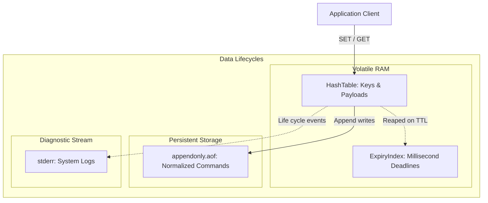

# KVForge — Privacy & Data Protection Specification

This document defines the privacy architecture, data handling practices, regulatory compliance considerations, and operational guidance for KVForge.

---

## 1. Privacy Principles & Architectural Scope

KVForge is designed as a self-contained, low-level in-memory data store. Its privacy posture adheres to the following principles:

1. **Zero External Telemetry:** KVForge contains **zero outbound network code**, phone-home routines, license validation beacons, or analytics collectors. The server will never transmit data outside its configured listen socket.
2. **Data Agnostic Storage:** KVForge treats keys and values as arbitrary, binary-safe byte arrays (`std::string`). It performs no content inspection, classification, indexing, or parsing of stored application payloads.
3. **Data Processor Role:** In regulatory frameworks (such as GDPR, CCPA/CPRA, and HIPAA), KVForge operates strictly as a data processing and storage component on behalf of the deploying application (the Data Controller).
4. **Privacy by Default:** By default, KVForge restricts network visibility to the local loopback interface (`127.0.0.1`), enforces strict file permissions (`0600`), and forbids logging payload contents.

---

## 2. Data Categories & Storage Mechanics

### 2.1 In-Memory Keyspace
- **Content:** Key identifiers, binary payload values, and absolute expiration timestamps.
- **Persistence:** Volatile. Cleared upon process termination unless reloaded from AOF.
- **Deallocation:** Memory occupied by keys and values is freed immediately upon `DEL`, overwrite, or active/lazy expiry reaping.

### 2.2 Append-Only File (`appendonly.aof`)
- **Content:** Exact stream of write commands (`SET`, `DEL`, `INCR`, `PEXPIREAT`, etc.) in RESP2 format.
- **Access Control:** Restricted to the service user (`mode 0600`).
- **Data Retention:** Stored records persist sequentially until the file is manually compacted or deleted by an operator.

### 2.3 Diagnostic Logs (`stderr`)
- **Content:** Operational lifecycle milestones, connection rejections, persistence errors, and warning events.
- **Privacy Protections:**
  - **Payload Values are NEVER logged** under any circumstance or log level.
  - **Key identifiers are excluded** at `INFO`, `WARN`, and `ERROR` levels.
  - Client IP addresses are recorded only for connection establishment and rejection diagnostics.

---

## 3. Regulatory Compliance Guidelines

Deployers of KVForge handling Personal Data or Personally Identifiable Information (PII) must observe the following regulatory considerations:

### 3.1 Right to Erasure / Right to be Forgotten (GDPR Art. 17, CCPA/CPRA)
- **In-Memory Deletion:** When a client issues `DEL <key>`, the key-value entry is immediately removed from the hash table and its memory is reclaimed.
- **AOF Persistence Nuance:** In append-only persistence architectures, issuing `DEL` appends a deletion record to the end of `appendonly.aof`. The historical `SET` command remains physically present in the earlier bytes of the file until the AOF is compacted or rotated.
- **Operational Requirement:** Organizations subject to strict right-to-erasure guarantees must either:
  1. Store sensitive data in KVForge with ephemeral TTLs and disabled AOF persistence (`appendonly no`), OR
  2. Implement periodic AOF file compaction / rotation, OR
  3. Deploy filesystem-level encryption (LUKS) so that storage decommissioning crypto-shreds all historical AOF copies.

### 3.2 Storage Limitation & Automated Data Expiration (GDPR Art. 5(1)(e))
- Personal data must not be stored longer than necessary for the stated processing purpose.
- KVForge provides native, deterministic TTL controls via `EXPIRE`, `PEXPIRE`, `PEXPIREAT`, and `SET ... EX/PX/PXAT`.
- The engine enforces timely expiration through dual mechanisms:
  - **Lazy Expiry:** Stale keys are dropped on the first lookup after expiration.
  - **Active Expiry:** An internal min-heap timer cycle reclaims untouched expired keys periodically without requiring client queries.

### 3.3 Right of Access & Data Portability (GDPR Art. 15, 20)
- All data associated with an identifiable key can be exported directly via standard commands (`GET`, `MGET`) using standard Redis client tooling (`redis-cli`, Python `redis`, etc.).

### 3.4 Data Minimization & Pseudonymization (GDPR Art. 25, 32)
- Application architects should avoid using raw plaintext personal identifiers as keyspace keys (e.g., avoid `user:alice.smith@example.com:profile`).
- Use cryptographically random UUIDs, salted hashes, or pseudonymous tokens (e.g., `user:8f9a2b1c-4d3e:profile`).

---

## 4. Encryption & Protection in Transit and at Rest

KVForge deliberately omits in-engine encryption to maintain architectural focus on core data structures and raw socket performance. Deployers are responsible for securing the environment:

### 4.1 Encryption in Transit
- Network packets over port 6380 are sent in cleartext RESP2.
- **Mandate:** Any transmission of sensitive or personal data over a shared or non-loopback network must be encapsulated inside an encrypted tunnel:
  - **TLS Reverse Proxy:** Terminate TLS using HAProxy, Envoy, or Stunnel colocated on the KVForge host.
  - **Virtual Private Network:** Enforce IPsec or WireGuard mesh networking between client applications and the KVForge instance.

### 4.2 Encryption at Rest
- To prevent unauthorized physical access to the AOF file:
  - Enable Linux Full-Disk Encryption (FDE) using LUKS (`cryptsetup`).
  - On cloud providers (AWS, Azure, GCP), enable managed disk encryption using Customer-Managed Keys (CMK) on volumes mounted to `/var/lib/kvforge`.

---

## 5. Privacy Impact Assessment (PIA) Checklist for Operators

Before storing user personal data in a KVForge instance, verify:

- [ ] **Network Isolation:** Service binds exclusively to `127.0.0.1` or a private tunnel.
- [ ] **AOF File Security:** File permissions verified as `0600`, directory as `0700`.
- [ ] **Data Retention Schedule:** Key expirations (TTLs) are configured on all personal data keys.
- [ ] **Volume Encryption:** Disk volume containing `/var/lib/kvforge` is encrypted at rest.
- [ ] **Log Scrubbing:** Confirmed that log collection agents (Fluentbit, Vector) do not ingest unauthorized diagnostic data.
- [ ] **Compaction & Rotation:** Backup retention schedules automatically prune historical AOF copies after defined retention windows.
